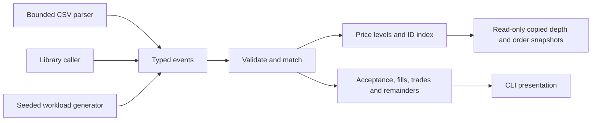
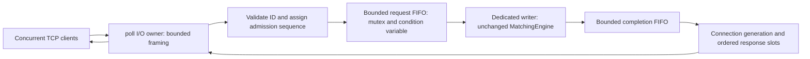

# Architecture

ExchangeCore's core is a single-threaded, deterministic C++20 library. The CLI,
CSV parser and benchmark runner use the same public engine API. The optional TCP
gateway adds one socket-I/O owner and one matching owner around that unchanged
API. There are no databases, wall-clock matching priorities or trading strategies.

`order.hpp`, `event.hpp` and `trade.hpp` define value types. `MatchingEngine`
enforces validation, lifetime ID uniqueness and price-time execution. `OrderBook`
owns price levels and resting orders. Core logic never writes to the console.
`csv.hpp` and `price.hpp` handle input and exact human-readable price formatting.

A single writer gives each accepted new order a monotonic arrival sequence and
avoids synchronization costs and ambiguous ordering between producer threads.
The caller must serialize access, including queries. This is a design choice,
not a claim that one thread scales to every exchange workload.

Queries return values: callers cannot mutate the book or hold its internal
iterators. Snapshots list bids in descending price order and asks in ascending
price order, with FIFO order within each level. Depth aggregates quantity and
order count. These interfaces support a read-only market data consumer without
introducing concurrency into the engine.

Expected invalid operations return explicit `RejectReason` values and leave
state unchanged. Capacity bounds accepted IDs across the entire engine lifetime,
including retired orders; default capacity is one million. Engine instances are
noncopyable and nonmovable because the order index stores container iterators.
Use RAII ownership (for example, `std::unique_ptr<MatchingEngine>`) if transferring
ownership between application components is needed.

Allocation failure is an exceptional resource failure. The matching path first
prepares execution records and stages any new ID/resting remainder, then commits
fills without allocation. See `MATCHING_RULES.md` and the allocation-failure tests
for the exact recovery contract. This costs a second traversal of filled makers
and keeps result delivery from allocating after liquidity has already changed.

The installed target is `ExchangeCore::exchangecore`. The public API does not
depend on Python, a test framework, or the benchmark executable.

## Optional gateway boundary

The I/O thread owns socket descriptors, buffers, monotonic connection tokens and
per-connection response slots. It parses requests and admits them into a bounded
FIFO, assigning a global processing sequence only on successful insertion. The
matching thread owns the engine and serially processes every admitted command,
including BEST/PING, before publishing results. Locks protect queue operations;
matching and socket calls execute outside those locks.

Completion values move across the boundary. They contain a connection token,
request ID, sequence and copied results, never a socket pointer or borrowed book
iterator. Disconnect destroys the socket while queued work continues. The I/O
owner discards an unroutable completion and cannot confuse it with a later
connection that reuses the same OS descriptor.

Per-connection response slots retain response order even for immediate seq0
errors. Large trade vectors stream as individual bounded lines through the fixed
output buffer. Input reads pause at output/pending limits; the shared request
queue uses explicit overload rejection. The core's lifetime-ID capacity bounds
engine state as well as preventing accidental order reuse across reconnects.

SIGINT/SIGTERM set a lock-free atomic flag. The I/O owner closes admission and
the request queue, continues draining completions while the writer drains accepted
work, then allows a response grace period. Slow clients cannot hold the writer
at join. See `CONCURRENCY.md` for detailed bounds and shutdown/error contracts.
