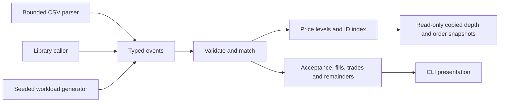

# Architecture

ExchangeCore is a single-threaded, deterministic C++20 library. The CLI, CSV
parser and benchmark runner use the same public engine API. There are no network
connections, background workers, databases, wall-clock ordering or trading strategies.

`order.hpp`, `event.hpp` and `trade.hpp` define value types. `MatchingEngine`
enforces validation, lifetime ID uniqueness and price-time execution. `OrderBook`
owns price levels and resting orders. Core logic never writes to the console.
`csv.hpp` and `price.hpp` handle input and exact human-readable price formatting.

A single writer gives each accepted new order a monotonic arrival sequence and
avoids synchronization costs and ambiguous ordering between producer threads.
The caller must serialize access, including queries. This is a design choice,
not a claim that one thread scales to every exchange workload.

Queries return values: callers cannot mutate the book or hold its internal
iterators. Snapshots list bids in descending price order and asks in ascending
price order, with FIFO order within each level. Depth aggregates quantity and
order count. These interfaces support a read-only market data consumer without
introducing concurrency into the engine.

Expected invalid operations return explicit `RejectReason` values and leave
state unchanged. Capacity bounds accepted IDs across the entire engine lifetime,
including retired orders; default capacity is one million. Engine instances are
noncopyable and nonmovable because the order index stores container iterators.
Use RAII ownership (for example, `std::unique_ptr<MatchingEngine>`) if transferring
ownership between application components is needed.

Allocation failure is an exceptional resource failure. The matching path first
prepares execution records and stages any new ID/resting remainder, then commits
fills without allocation. See `MATCHING_RULES.md` and the allocation-failure tests
for the exact recovery contract. This costs a second traversal of filled makers
and keeps result delivery from allocating after liquidity has already changed.

The installed target is `ExchangeCore::exchangecore`. The public API does not
depend on Python, a test framework, or the benchmark executable.
