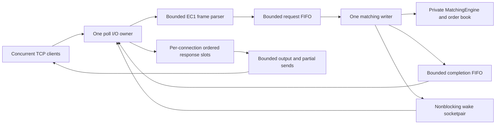

# Gateway concurrency and resource ownership

The optional TCP gateway adds concurrency around the existing single-threaded
matching engine. The in-process library, original CLI and core benchmark do not
depend on the gateway or acquire its locks.

## Ownership and synchronization

The thread running `run_gateway` owns the listener, client descriptors, poll
state, connection map, input/output strings, response cursors and connection
lifetime. Socket wrappers close descriptors through RAII. Descriptors are
nonblocking and close-on-exec. An internal socketpair wakes the I/O owner when
the writer publishes a completion; the writer borrows its write endpoint until
it is joined. Client descriptor ownership is never transferred to the writer.

One dedicated `std::jthread` exclusively processes the matching engine, including
BEST queries and its final invariant check. Requests and completions cross the
thread boundary as owned values. A completion owns its Result and trade vector;
the queues and pending slots move those values rather than sharing mutable book
objects or exposing internal iterators.

Each FIFO uses a fixed vector of optional slots, a mutex and readable/writable
condition variables. A successful push is its admission point. Pop removes the
oldest admitted value. Mutex ownership ends before parsing, matching, response
formatting or socket I/O. No network operation or matching sweep holds a queue
lock. The I/O owner uses nonblocking `try_push`/`try_pop`; the matching writer
waits for requests and, when necessary, completion capacity.

The standalone server's SIGINT/SIGTERM handler performs only a relaxed store to
an always-lock-free `std::atomic<bool>`, checked by a compile-time assertion. The
I/O loop observes that stop flag; it performs cleanup in ordinary thread context.
Separate atomics carry processed counts, writer completion and invariant-failure
status. Writer-done publication uses release/acquire ordering. Queue mutexes
provide synchronization for the payloads; relaxed counters do not publish data.

The single writer preserves one explicit order without locks inside matching.
Clients on different TCP connections can become ready in different orders
between runs. The I/O owner assigns globally increasing processing sequences
when request-FIFO admission succeeds, and the writer consumes that sequence in
FIFO order. Responses preserve each connection's original frame order, including
local errors waiting behind an earlier queued request. BEST observes state at its
processing position. This does not promise repeatable concurrent network arrival
order or a durable replay log. See [NETWORK_PROTOCOL.md](NETWORK_PROTOCOL.md).

## Bounds and backpressure

The defaults below are independently configurable within validated limits.
High-water counters are reported in the server's final STATS line.

| Resource | Default limit | Behavior at the limit |
|---|---:|---|
| Client connections | 128 | Newly accepted excess descriptors are closed. |
| Request FIFO | 1024 entries | Admission returns OVERLOADED; no sequence or matching attempt is assigned. |
| Completion FIFO | 1024 entries | Writer waits; I/O continues draining completions independently of socket writability. |
| Pending responses per client | 16 entries | Further application reads/admission on that connection pause. |
| Input per client | 4096 frame bytes, plus one detection byte | Oversized frames receive an error and close after pending output. |
| Output per client | 65,536 bytes | Serialization pauses; its cursor resumes as bytes are sent. |
| Lifetime accepted order IDs | 1,000,000 | Further new orders reject with CAPACITY_EXCEEDED. |

`queue_high_water` and `completion_high_water` measure shared FIFO occupancy.
`input_high_water`, `output_high_water` and `pending_high_water` record the largest
observed occupancy of an individual connection, rather than sums across clients.
Input buffering includes a received LF or the extra byte used to detect an
overlong frame, so its high water may reach `max_input + 1`. Output's logical
string length never exceeds `max_output`; an offset tracks its already sent
prefix until compaction. Kernel socket buffers are additional OS-managed memory.

The pending slot is allocated before a request enters the shared FIFO. Therefore
admission cannot succeed and then lose its route because a subsequent slot
allocation failed. A full FIFO instead produces an ordered local OVERLOADED
response. Its syntactically valid request ID is consumed, so clients must retry
using a higher request ID. No order acceptance is sent before matching returns.

Partial sends advance only the number of bytes actually written. EINTR retries;
EAGAIN/EWOULDBLOCK return to poll rather than blocking another connection. Reads
also preserve incomplete frames, process coalesced lines and return to poll when
the socket would block. Per-cycle read/write budgets and a bounded accept batch
limit one connection's work. This is best-effort fairness, not a latency or
starvation guarantee.

Replies are serialized one bounded header, TRADE or END line at a time. A sweep
with many fills can exceed the output-buffer limit as a complete response while
still streaming through that fixed logical bound. The Result's trade vector
remains owned by its completion/pending slot until serialization finishes.
Its length is bounded by the number of matched makers and ultimately configured
order capacity; it is not reduced to a constant-sized object by streaming.
Several retained Results can therefore consume substantial additional memory.

The request/completion ring slots are allocated up front, and connection strings
reserve their configured capacities. The entire server is **not** preallocated:
map/list/hash nodes, pending deque storage, formatter strings and trade vectors
still allocate. String/container capacity can exceed logical element counts.
Lifetime ID storage grows even after fills and cancellations, until max_orders;
active book storage is bounded by that same lifetime capacity. Entry limits and
buffer limits give finite configured bounds, rather than a small fixed process
byte budget or a promise of availability under memory exhaustion. RSS statistics
are whole-process high-water measurements, not precise live-book accounting.

## Disconnection and routing

Every connection receives a monotonically increasing internal token separate
from its file descriptor. Queued requests and completions contain that token and
the processing sequence, never pointers to Connection objects. A reused OS file
descriptor cannot receive an old connection's reply. Completion routing requires
a live matching token and response slot.

Disconnecting does not cancel queued orders or roll back completed matching.
The writer continues attempting every admitted request. Completions for vanished
connections are discarded; the server does not deliver them to a reconnecting
client. Reconnects start a new request-ID namespace, while accepted order IDs
remain global to the same engine lifetime. There is no response replay cache or
exactly-once response-delivery guarantee. Trade records go only to the submitting
request, without an unsolicited maker notification.

A normal FIN on the client's write side still permits sending its queued replies.
A final nonempty frame without LF is never admitted and gets INCOMPLETE_FRAME
when a response can be sent. Socket reset, broken pipe or invalid descriptor
closes that client without terminating healthy connections. Linux uses
`MSG_NOSIGNAL` on sends; macOS configures `SO_NOSIGPIPE`. EINTR during close is not
retried because the descriptor may already have been released. A reset during
per-client socket setup is counted as a setup failure and closes that accepted
descriptor through RAII.

## Shutdown and exceptional paths

Normal SIGINT/SIGTERM shutdown first closes the listener and request admission,
marks client reads closed and discards unadmitted input. Closing the request FIFO
rejects producers, wakes its waiters and permits already admitted values to drain.
The matching writer attempts each remaining request in sequence and publishes a
completion. An expected engine validation failure is a REJECT; an exceptional
processing failure is explicit INTERNAL with its positive processing sequence.
Neither an error nor a disconnected recipient makes the writer skip later work.

The I/O owner continues draining completions while the writer runs. Once the
writer finishes the admitted queue and its final invariant check, the response
grace deadline starts: **two seconds by default**, configurable from zero to
60 seconds. Responsive clients may finish sooner; slow or disconnected clients
do not extend that deadline. Grace expiry can discard replies, but it starts
only after admitted processing attempts finish. There is no corresponding fixed
time bound on draining an arbitrarily expensive admitted matching workload.

The writer's owned engine is released when its thread callable finishes. The
worker is joined before queues or wake descriptors are destroyed.
On an I/O/runtime exception, cleanup closes both queues before joining. This
unblocks a writer waiting on a full completion FIFO; it continues draining the
admitted requests, while completion publication may be discarded because I/O
cannot continue. The server reports the runtime failure instead of claiming a
successful clean shutdown. Startup exceptions unwind socket/queue RAII owners.

For normal shutdown, STATS distinguishes queue `accepted` from writer
`processed`, overloads, malformed requests and disconnected completion discards.
Accepted here means queue admission, not engine acceptance. `processed` counts
attempts, including queries, matching rejections and INTERNAL failures. The
standalone server checks `accepted == processed` before returning success.
These counters do not prove that a remote client received END or that a maker
received a separate execution notification.

`discarded` counts unroutable completions and pending results removed before
serialization finishes, including completions left at shutdown. A response whose
END is already in the bounded output buffer is no longer tracked as a pending
result, even if a later disconnect prevents delivery. The counter is not a
complete transport-loss count or a delivery acknowledgment.

This design has no authentication, TLS, account isolation, per-client cancellation
authorization, durable journal or reconnect recovery. Keep it on loopback for
local demonstrations. Its concurrency and resource-management mechanisms do not
make it a production exchange or a hardened public endpoint.
